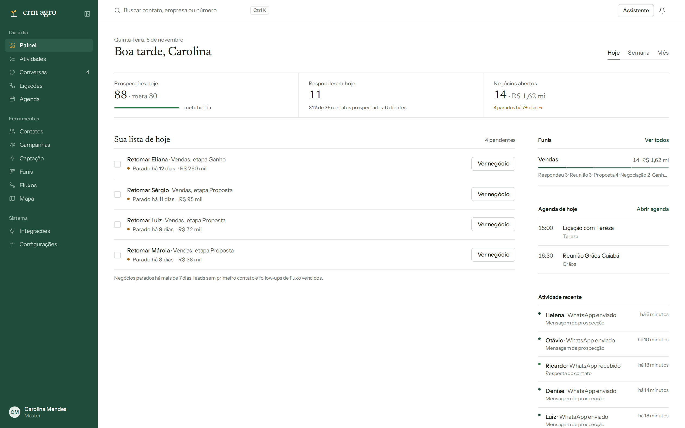
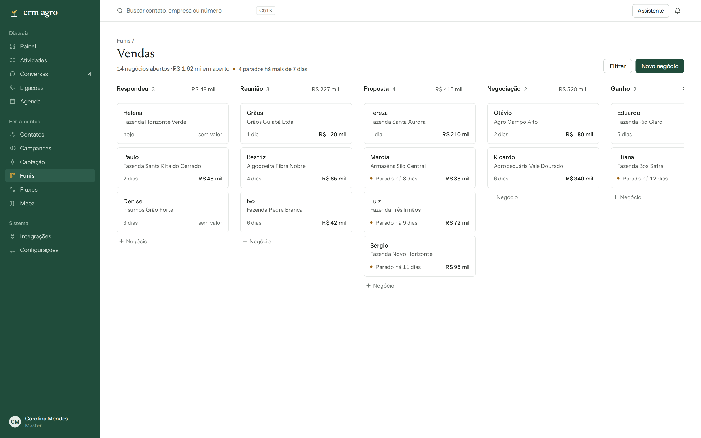
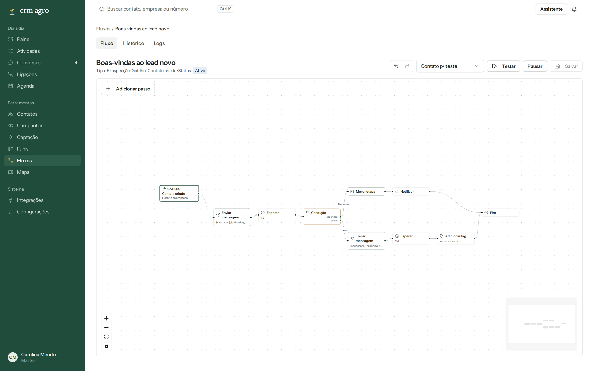
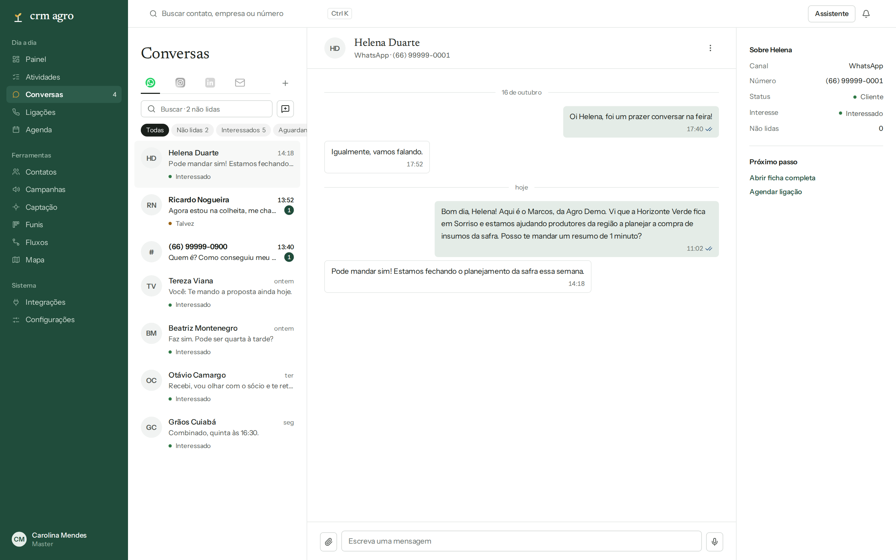
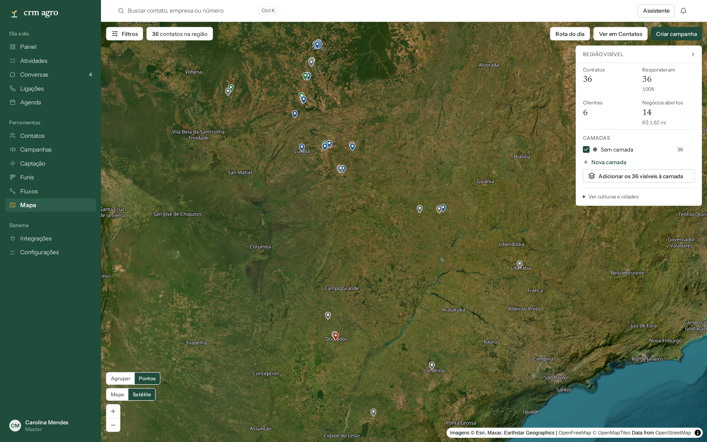

# CRM Agro

CRM de prospecção para o agro, de código aberto. Uma base única de contatos e um motor de automação em cima dela: funis, conversas de WhatsApp em tempo real, fluxos visuais, campanhas, agenda, mapa e captação.

> **English:** open-source prospecting CRM for agribusiness. One contact database plus an automation engine on top: kanban funnels, real-time WhatsApp inbox (Evolution API), a visual flow builder, campaigns, calendar, map and lead capture. Multi-tenant, TypeScript, Next.js, Prisma/PostgreSQL, BullMQ/Redis. Setup guides for local, VPS and Vercel below.

<p align="center">
  
</p>

<table>
  <tr>
    <td width="50%"><br><sub>Funil de vendas em kanban</sub></td>
    <td width="50%"><br><sub>Editor visual de fluxos</sub></td>
  </tr>
  <tr>
    <td width="50%"><br><sub>Conversas de WhatsApp e e-mail</sub></td>
    <td width="50%"><br><sub>Contatos no mapa, em satélite</sub></td>
  </tr>
</table>

Mais telas, inclusive no tema escuro e em formato de post do LinkedIn, em [`screenshots/`](screenshots). Os dados dos prints são fictícios.

## O que ele faz

- **Contatos como espinha.** Cadastro, importação de planilha, busca por qualquer dado, enriquecimento por CNPJ e verificador de agro (produtor, fazenda, armazém, algodoeira, pecuária, transportadora).
- **Funis em kanban.** Arrastar o negócio entre etapas dispara automações.
- **Conversas em tempo real.** Inbox de WhatsApp (Evolution API) e e-mail no mesmo lugar.
- **Fluxos visuais.** Editor de nós (mensagem, espera, condição, teste A/B, etapa do funil, tag, IA) com um motor que garante idempotência, retry e versão congelada por contato.
- **Campanhas.** Disparo por lista com limite diário, variações de texto, janela de envio e opt-out.
- **Painel do dia.** A meta do mês vira a lista de toques de hoje.
- **Agenda, Mapa e Captação.** Compromissos com Google Agenda, contatos no mapa e captação por CNPJ e fontes públicas. A captação pelo Google Maps e pelo Instagram é experimental e pode contrariar os termos dessas plataformas (veja o aviso legal).
- **Multiempresa.** Isolamento por time em toda tabela (fail-closed), permissões por papel e RLS opcional no Postgres.

Mais detalhes em [`docs/arquitetura.md`](docs/arquitetura.md).

> **Projeto em evolução.** O núcleo funciona, mas ainda faltam partes: formulários e tabelas de preço nos funis, integrações oficiais com redes sociais, Meta Ads e Google Ads, integrações com outros CRMs, API própria, dashboards no painel e ligações de dentro da plataforma. A lista completa está no [`ROADMAP.md`](ROADMAP.md).

## Começar em 5 minutos

Você precisa de Node 20+, pnpm 9 e Docker.

```bash
git clone https://github.com/llmsa2025/CRM-Agro.git && cd CRM-Agro
pnpm install
cp .env.example .env
sed -i "s|^AUTH_SECRET=.*|AUTH_SECRET=\"$(openssl rand -base64 48)\"|" .env
sed -i "s|^CREDENTIALS_ENCRYPTION_KEY=.*|CREDENTIALS_ENCRYPTION_KEY=\"$(openssl rand -base64 48)\"|" .env
docker compose up -d        # PostgreSQL e Redis
pnpm db:migrate
pnpm db:seed:demo           # dados fictícios para explorar
pnpm dev                    # http://localhost:3001
```

Entre em <http://localhost:3001> (use `localhost`) com `demo@crmagro.example` e `DemoCrmAgro2026!`.

## Guias de instalação

| Quero rodar | Guia |
|---|---|
| Na minha máquina | [`docs/instalacao-local.md`](docs/instalacao-local.md) |
| Num servidor (VPS, Ubuntu, pm2 e Caddy com HTTPS) | [`docs/deploy-vps.md`](docs/deploy-vps.md) |
| Na Vercel (site) com o worker em outro lugar | [`docs/deploy-vercel.md`](docs/deploy-vercel.md) |
| Pedir para uma IA colocar no ar | Aponte a IA para o [`AGENTS.md`](AGENTS.md): é um roteiro com comandos e como conferir cada passo |
| Entender cada variável do `.env` | [`docs/variaveis-de-ambiente.md`](docs/variaveis-de-ambiente.md) |
| Carregar a demo e tirar prints | [`docs/demo-e-prints.md`](docs/demo-e-prints.md) |

> Dica: abra o repositório no Claude Code, Cursor ou Codex e diga "coloque o CRM Agro para rodar, siga o AGENTS.md". O roteiro cobre local, VPS e Vercel.

## Stack

TypeScript estrito · Next.js (App Router) e React · Tailwind e shadcn/ui · Prisma e PostgreSQL · BullMQ e Redis · Socket.IO · NextAuth v5 · React Flow · dnd-kit · zod · Evolution API (WhatsApp).

```
apps/web       telas e API (Next.js + Socket.IO)
apps/worker    motor de fluxos e filas (processo contínuo)
packages/core  domínio e serviços
packages/db    schema Prisma, migrations, isolamento por time
packages/channels   WhatsApp, e-mail, redes sociais
packages/captation  Maps, CNPJ, Instagram
```

## Uso responsável

Este é um software de prospecção. Respeite a LGPD, os termos de cada canal e os limites de envio. O WhatsApp não oficial (Evolution API) pode banir números em disparo em massa. Veja [`SECURITY.md`](SECURITY.md).

## Aviso legal

- **Projeto independente.** Não tem afiliação, patrocínio nem endosso de WhatsApp, Meta, Instagram, Google, LinkedIn, Evolution API, Nectar CRM, Voopi, RD Station, Agendor, Pipedrive, Reev, Plaud, Anthropic, OpenAI ou de qualquer outra empresa citada. Os nomes e as marcas pertencem aos seus donos e aparecem só para dizer com o que o software se integra.
- **Dados fictícios.** Os dados dos exemplos, da base de demonstração e dos prints são inventados. Qualquer semelhança com pessoas ou empresas reais é coincidência.
- **Sem garantia.** O software é fornecido "como está", nos termos da licença MIT. Quem o opera responde pelo uso, inclusive pela LGPD, pelos termos de cada plataforma e pelos limites de envio.
- **Captação e automação são por sua conta e risco.** Raspar sites e redes sociais, ou automatizar uma sessão logada, pode contrariar os termos da plataforma e levar a bloqueio da conta ou a medidas legais. Os recursos de Google Maps, Instagram e LinkedIn são experimentais.
- **Serviços de terceiros.** O mapa usa tiles do OpenFreeMap e do OpenStreetMap e, na visão de satélite, imagens da Esri. Confira os termos de cada provedor antes de uso comercial.
- **Não é orientação jurídica.** Em caso de dúvida sobre captação, disparo ou tratamento de dados pessoais, consulte um profissional.

## Contribuir e licença

Contribuições são bem-vindas: veja [`CONTRIBUTING.md`](CONTRIBUTING.md). Licença [MIT](LICENSE).
